# PANDUAN PENGGUNAAN SISTEM INFORMASI WAKAF NAHDLATUL ULAMA (SIWAKNU)
**Lembaga Wakaf dan Pertanahan Nahdlatul Ulama (LWPNU)**  
Portal Admin: [https://wakafnusa.siwaknu.id/lwp/login](https://wakafnusa.siwaknu.id/lwp/login)  
Portal Pendaftaran: [https://wakafnusa.siwaknu.id/lwp/register](https://wakafnusa.siwaknu.id/lwp/register)

---

## DAFTAR ISI
- [1. Pendahuluan](#1-pendahuluan)
- [2. Pendaftaran Pengguna Baru (Registrasi Akun)](#2-pendaftaran-pengguna-baru-registrasi-akun)
  - 2.1 [Alamat Portal Pendaftaran](#21-alamat-portal-pendaftaran)
  - 2.2 [Formulir dan Langkah Registrasi](#22-formulir-dan-langkah-registrasi)
  - 2.3 [Ketentuan Penting: Verifikasi Admin untuk Entri Data Wakaf](#23-ketentuan-penting-verifikasi-admin-untuk-entri-data-wakaf)
- [3. Akses dan Login Sistem](#3-akses-dan-login-sistem)
  - 3.1 [Alamat Portal Login](#31-alamat-portal-login)
  - 3.2 [Kredensial Akun Administrator](#32-kredensial-akun-administrator)
  - 3.3 [Langkah-Langkah Masuk](#33-langkah-langkah-masuk)
- [4. Dashboard Utama](#4-dashboard-utama)
- [5. Peta Sebaran Aset Wakaf](#5-peta-sebaran-aset-wakaf)
- [6. Manajemen Aset Wakaf](#6-manajemen-aset-wakaf)
  - 6.1 [Tampilan Data (Tabel vs Kartu)](#61-tampilan-data-tabel-vs-kartu)
  - 6.2 [Pencarian dan Filter Lokasi Berjenjang](#62-pencarian-dan-filter-lokasi-berjenjang)
  - 6.3 [Paginasi dan Navigasi Halaman](#63-paginasi-dan-navigasi-halaman)
  - 6.4 [Perekaman Aset Wakaf Baru (Input Wizard)](#64-perekaman-aset-wakaf-baru-input-wizard)
  - 6.5 [Aksi Data: Detail, Peta, Berkas, Edit, Verifikasi, dan Hapus](#65-aksi-data-detail-peta-berkas-edit-verifikasi-dan-hapus)
- [7. Pengajuan Wakif (Layanan Publik)](#7-pengajuan-wakif-layanan-publik)
- [8. Laporan dan Rekapitulasi Data](#8-laporan-dan-rekapitulasi-data)
  - 8.1 [Filter Laporan Berjenjang](#81-filter-laporan-berjenjang)
  - 8.2 [Ekspor Dokumen (PDF dan Excel)](#82-ekspor-dokumen-pdf-dan-excel)
- [9. Manajemen Pengguna (Data Pengguna & Verifikasi Akun)](#9-manajemen-pengguna-data-pengguna--verifikasi-akun)
- [10. Data Sampah (Tempat Pemulihan Data)](#10-data-sampah-tempat-pemulihan-data)
- [11. Pengaturan Profil dan Kata Sandi](#11-pengaturan-profil-dan-kata-sandi)
- [12. Petunjuk Keamanan & Tips Operasional](#12-petunjuk-keamanan--tips-operasional)

---

## 1. PENDAHULUAN
**SIWAKNU (Sistem Informasi Wakaf Nahdlatul Ulama)** adalah platform tata kelola terintegrasi milik Lembaga Wakaf dan Pertanahan Nahdlatul Ulama (LWPNU) untuk mendata, memvalidasi, memonitor, dan melaporkan seluruh aset wakaf tanah dan properti di lingkungan Nahdlatul Ulama secara akuntabel, transparan, dan terstruktur sesuai regulasi perwakafan di Indonesia dan Peraturan Perkumpulan Nahdlatul Ulama.

---

## 2. PENDAFTARAN PENGGUNA BARU (REGISTRASI AKUN)

### 2.1 Alamat Portal Pendaftaran
Bagi pengurus LWPNU yang belum memiliki akun, pendaftaran mandiri dapat dilakukan secara online melalui tautan resmi:  
👉 **[https://wakafnusa.siwaknu.id/lwp/register](https://wakafnusa.siwaknu.id/lwp/register)**

### 2.2 Formulir dan Langkah Registrasi:
1. Buka link pendaftaran di peramban web Anda.
2. Lengkapi formulir pendaftaran yang terbagi dalam dua kelompok data:
   - **Informasi Pribadi**:
     - *Nama Lengkap*: Nama lengkap calon pengurus.
     - *Username*: Nama pengguna unik untuk keperluan login (tanpa spasi).
     - *Email*: Alamat email aktif untuk menerima konfirmasi akun.
     - *Kata Sandi*: Minimal 6 karakter.
     - *Konfirmasi Kata Sandi*: Masukkan ulang kata sandi yang sama.
   - **Informasi Pengurus & Wilayah Penugasan**:
     - *Nomor Telepon*: Nomor kontak WhatsApp aktif.
     - *Nomor KARTANU*: Nomor Kartu Tanda Anggota NU (opsional/wajib jika ada).
     - *Provinsi*: Pilih provinsi domisili penugasan.
     - *Kota / Kabupaten*: Pilih kabupaten/kota penugasan.
     - *Kecamatan*: Pilih kecamatan penugasan.
     - *Kelurahan / Desa*: Pilih desa/kelurahan setempat.
3. Klik tombol hijau **Daftar Akun Sekarang**.

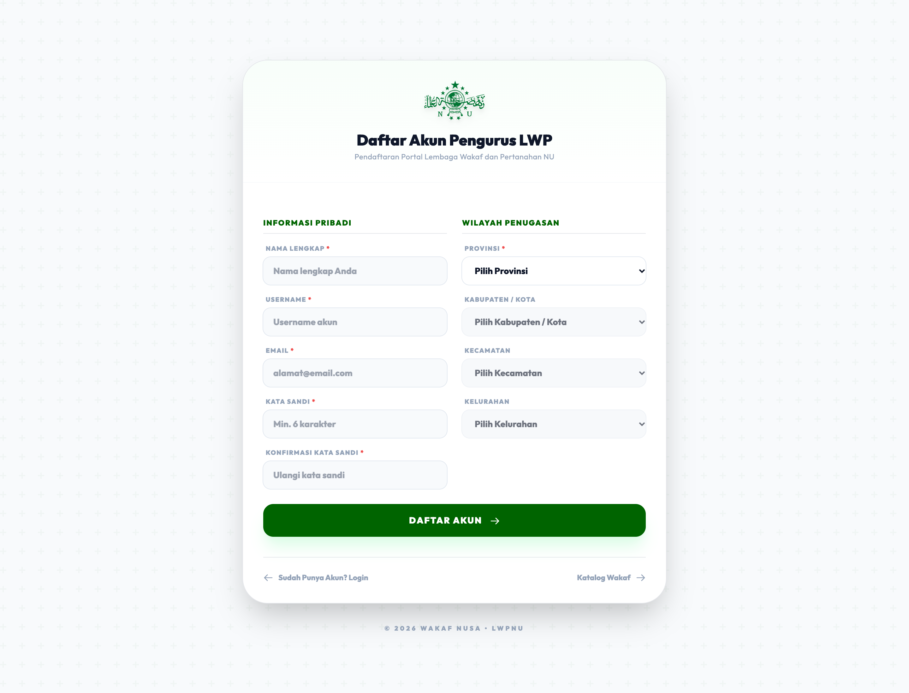

### 2.3 Ketentuan Penting: Verifikasi Admin untuk Entri Data Wakaf
> ⚠️ **PENTING DIBERITAHUKAN KEPADA PENGGUNA BARU:**  
> Setelah proses pendaftaran berhasil dan email terverifikasi, akun baru tersebut **belum dapat langsung melakukan entri data wakaf**.
> 
> Sesuai Standar Operasional Prosedur (SOP) tata kelola LWPNU:
> 1. Akun baru yang terdaftar akan masuk ke dalam antrean sistem dengan status awal sebagai *User Baru (Belum Terverifikasi)*.
> 2. **Administrator Utama (Level 9 / PBNU)** atau **Admin Wilayah (PWNU/PCNU)** akan memeriksa dan melakukan **verifikasi legalitas kepengurusan** akun tersebut melalui menu *Data Pengguna*.
> 3. Admin akan menetapkan tingkat wewenang (*Level Hak Akses*) yang sesuai, seperti **MWCNU (Level 2)**, **PCNU (Level 3)**, atau **PWNU (Level 31)**.
> 4. **Hanya setelah akun diverifikasi dan diberikan level oleh Admin**, menu **Manajemen Wakaf** dan tombol **Input Aset Baru** akan terbuka dan dapat digunakan untuk mengentri data tanah wakaf.

---

## 3. AKSES DAN LOGIN SISTEM

### 3.1 Alamat Portal Login
Buka peramban (browser) seperti Google Chrome, Mozilla Firefox, atau Microsoft Edge, lalu akses alamat:  
👉 **[https://wakafnusa.siwaknu.id/lwp/login](https://wakafnusa.siwaknu.id/lwp/login)**

### 3.2 Kredensial Akun Administrator
- **Username**: `praja`
- **Kata Sandi (Password)**: `rahasia123`
- **Tingkat Akses (Role)**: Administrator Utama (Level 9) — Memiliki wewenang penuh nasional dan seluruh wilayah.

### 3.3 Langkah-Langkah Masuk:
1. Masukkan `praja` pada kolom **Username**.
2. Masukkan `rahasia123` pada kolom **Password**.
3. Klik tombol **Masuk ke Dashboard**.
4. Sistem akan melakukan autentikasi dan langsung mengarahkan Anda ke halaman **Dashboard Utama**.

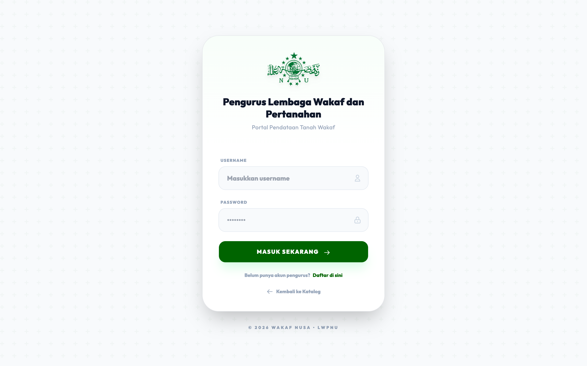

---

## 4. DASHBOARD UTAMA
Halaman Dashboard menyajikan ringkasan statistik terkini perwakafan:
1. **Kartu Statistik Utama**:
   - **Total Aset Wakaf**: Jumlah seluruh bidang tanah wakaf yang tercatat.
   - **Total Luas Tanah**: Akumulasi luas tanah wakaf (dalam meter persegi / m²).
   - **Wilayah Terdata**: Jumlah kabupaten/kota yang aktif memiliki data wakaf.
   - **Status Verifikasi**: Proporsi aset yang sudah terverifikasi (status hijau) vs belum terverifikasi (status kuning/oranye).
2. **Top Kabupaten/Kota**:
   - Menampilkan daftar kabupaten/kota dengan jumlah aset wakaf terbanyak.
   - Dilengkapi kolom pencarian instan nama wilayah.

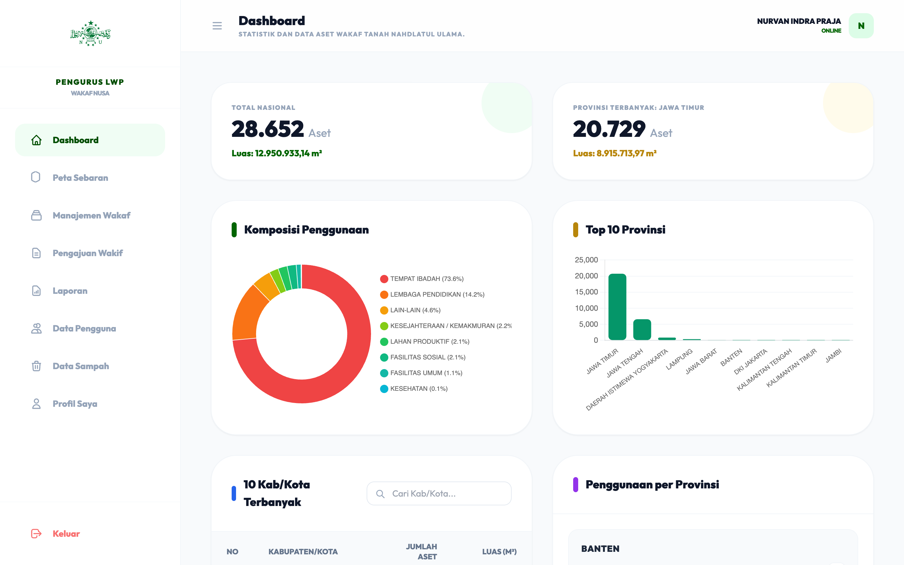

---

## 5. PETA SEBARAN ASET WAKAF
*(Menu khusus Administrator Level 9)*
- **Akses**: Menu Sidebar &rarr; **Peta Sebaran**.
- **Fungsi**:
  - Menampilkan sebaran titik lokasi aset wakaf secara visual berbasis OpenStreetMap.
  - Setiap marker mewakili titik koordinat bidang tanah wakaf (Masjid, Musholla, Lembaga Pendidikan, Makam, dll.).
  - Klik pada pin lokasi untuk melihat ringkasan singkat: Penggunaan, Alamat, Luas Tanah, dan Nama Wakif.
  - Anda dapat melakukan filter sebaran berdasarkan level provinsi maupun kabupaten/kota.

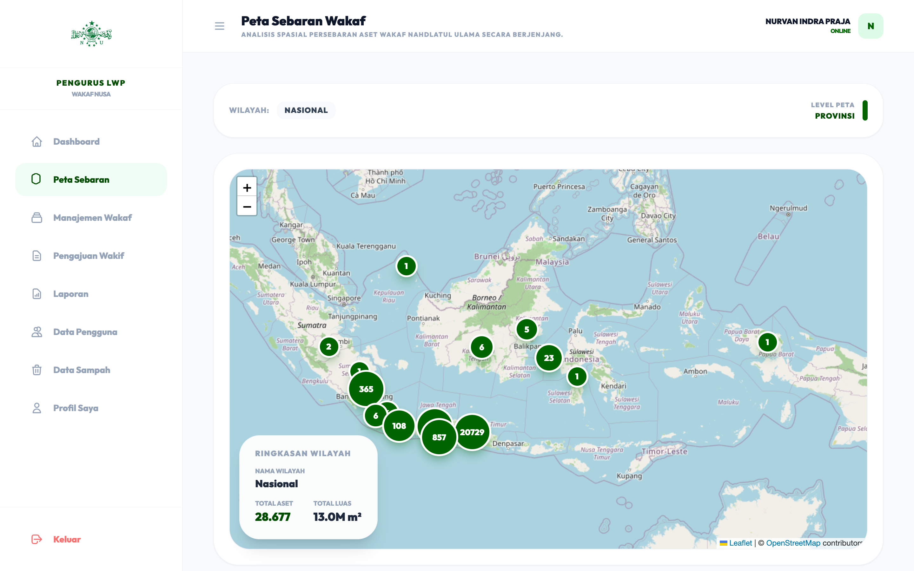

---

## 6. MANAJEMEN WAKAF
Menu **Manajemen Wakaf** adalah modul utama untuk mengelola database aset wakaf tanah NU.

### 6.1 Tampilan Data (Tabel vs Kartu)
Di pojok kiri atas terdapat toggle tampilan:
- **Tampilan Tabel** (Ikon baris): Cocok untuk layar monitor komputer/laptop guna melihat data secara padat dan terstruktur.
- **Tampilan Kartu** (Ikon grid): Format kartu modern yang sangat nyaman dibaca pada layar tablet atau smartphone.

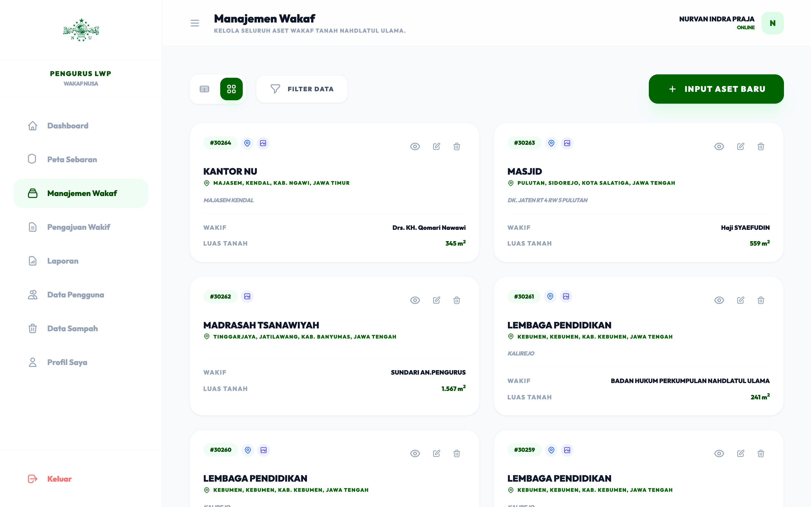

### 6.2 Pencarian dan Filter Lokasi Berjenjang
Klik tombol **Filter Data** untuk menampilkan panel pencarian:
1. **Filter Teks**:
   - **Nama Wakif**: Mencari berdasarkan nama pemberi wakaf.
   - **Penggunaan**: Mencari peruntukan tanah (contoh: *Masjid*, *Musholla*, *Madrasah*, *Pondok Pesantren*, *Makam*).
   - **Kata Kunci Alamat / Wilayah**: Pencarian cepat teks bebas alamat.
2. **Filter Lokasi Berjenjang (Hierarkis)**:
   - **Provinsi**: Pilih provinsi yang diinginkan (misal: *Jawa Timur*).
   - **Kota / Kabupaten**: Dropdown akan otomatis memuat daftar kota/kabupaten di bawah provinsi yang dipilih.
   - **Kecamatan**: Dropdown otomatis memuat kecamatan di bawah kabupaten terkait.
   - **Kelurahan / Desa**: Dropdown otomatis memuat kelurahan/desa di bawah kecamatan terkait.
3. **Tombol Terapkan Filter**: Klik untuk memproses pencarian. Tombol Filter Data akan menampilkan badge hijau sebagai penanda bahwa filter sedang aktif.
4. **Tombol Reset**: Menghapus seluruh filter kembali ke tampilan awal semua data.

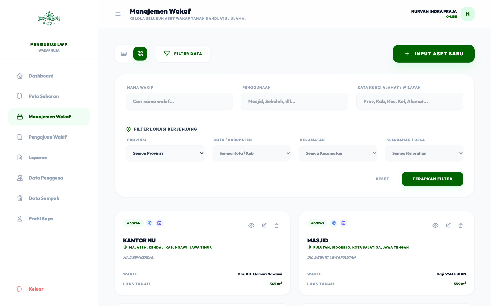

### 6.3 Paginasi dan Navigasi Halaman
- Jika data hasil filter berjumlah lebih dari 10 baris, tombol halaman (halaman 1, 2, 3, dst.) akan muncul di bagian bawah.
- **Paginasi Cerdas**: Saat berpindah halaman (misal ke Halaman 2), parameter filter tetap terjaga dan tidak akan hilang.

### 6.4 Perekaman Aset Wakaf Baru (Input Wizard)
Untuk menambahkan data aset baru, klik tombol hijau **+ Input Aset Baru** di pojok kanan atas. Formulir menggunakan 5 langkah wizard terpadu:
- **Langkah 1 (Lokasi Wilayah)**:
  Pilih secara berurutan: Provinsi &rarr; Kabupaten/Kota &rarr; Kecamatan &rarr; Kelurahan/Desa &rarr; isi Alamat Rinci.
- **Langkah 2 (Legalitas Dokumen)**:
  Isi Nomor Akta Ikrar Wakaf (AIW/APAIW), Tanggal AIW, Nomor Sertifikat Wakaf, Tanggal Sertifikat, Status Sengketa, dan Status Tanah. Sistem memiliki validasi otomatis untuk mencegah duplikasi nomor AIW/Sertifikat.
- **Langkah 3 (Identitas & Penggunaan)**:
  Isi Nama Wakif, Nama Nazhir, Peruntukan/Penggunaan Tanah, dan Luas Tanah (m²).
- **Langkah 4 (Titik Koordinat Peta)**:
  Tentukan posisi koordinat GPS (Latitude dan Longitude) dengan mengklik langsung pada peta interaktif atau mengisi angka koordinat.
- **Langkah 5 (Upload Berkas Gambar/Dokumen)**:
  Unggah foto fisik tanah/bangunan atau dokumen pendukung (format JPG, PNG, atau PDF).
- Klik **Simpan Aset Baru** untuk menyelesaikan pendaftaran aset.

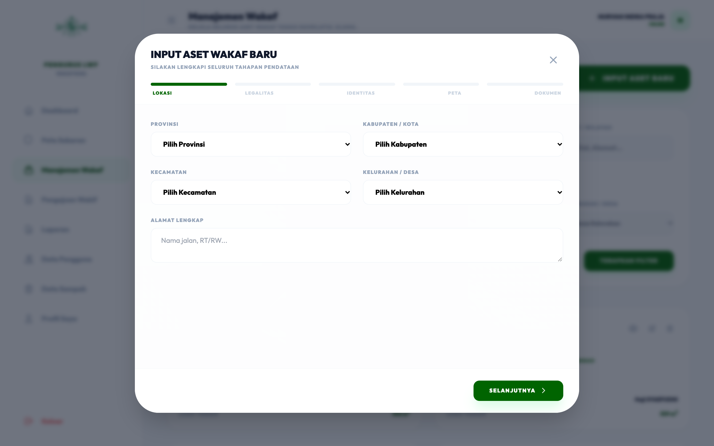

### 6.5 Aksi Data
Pada setiap baris/kartu data aset, tersedia tombol aksi interaktif:
1. **Ikon Pin Peta (Biru)**: Membuka pop-up peta langsung pada titik koordinat aset.
2. **Ikon Dokumen/Foto (Indigo)**: Membuka galeri berkas gambar dan pratinjau PDF bukti wakaf.
3. **Ikon Mata (Detail)**: Menampilkan lembar ringkasan aset lengkap, profil inputter, dan riwayat entri (audit trail).
4. **Ikon Pensil (Edit)**: Membuka formulir pengubahan data aset dan penambahan berkas baru.
5. **Ikon Sampah (Hapus)**: Memindahkan data aset ke folder sampah (soft delete).
6. **Tombol Verifikasi**: Khusus untuk aset berstatus *Belum Terverifikasi* (baris berwarna kekuningan), klik Verifikasi untuk menetapkan status sah terverifikasi.

---

## 7. PENGAJUAN WAKIF (LAYANAN PUBLIK)
Menu **Pengajuan Wakif** berfungsi mengelola permohonan wakaf tanah yang diajukan secara online oleh masyarakat umum atau wakif melalui portal publik:
1. **Daftar Permohonan**: Memuat nama pemohon, lokasi tanah, luas, dan status pengajuan:
   - *Diajukan* (Menunggu verifikasi administrasi).
   - *Verifikasi Lapangan* (Tahap peninjauan fisik lokasi oleh pengurus).
   - *Selesai* (Telah disetujui dan diekspor ke database SIWAKNU).
   - *Dibatalkan* (Permohonan ditolak atau tidak memenuhi syarat).
2. **Proses Verifikasi Lapangan**: Buka detail permohonan &rarr; masukkan catatan hasil survei lapangan & nama petugas pemeriksa &rarr; klik Simpan Verifikasi Lapangan.
3. **Ekspor ke SIWAKNU**: Setelah tanah dinyatakan sah dan lengkap, klik **Ekspor ke SIWAKNU** agar data otomatis masuk ke database Manajemen Wakaf tanpa perlu menginput ulang secara manual.

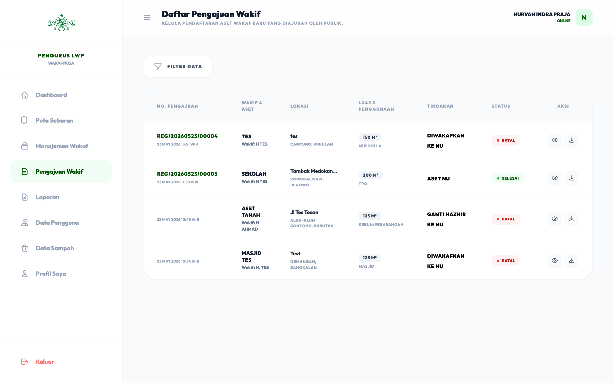

---

## 8. LAPORAN DAN REKAPITULASI DATA
Modul **Laporan** digunakan untuk membuat rekapitulasi data aset wakaf, baik untuk keperluan arsip internal, laporan berkala ke BWI (Badan Wakaf Indonesia), maupun pelaporan ke jajaran Pengurus NU (PBNU/PWNU/PCNU).

### 8.1 Filter Laporan Berjenjang
Pilih cakupan wilayah pada dropdown:
- **Provinsi**: Menampilkan rekapitulasi per Kabupaten/Kota di provinsi tersebut.
- **Kabupaten / Kota**: Menampilkan rekapitulasi per Kecamatan di bawah kabupaten tersebut.
- **Kecamatan**: Menampilkan rekapitulasi per Kelurahan/Desa.
- **Kelurahan**: Menampilkan rekapitulasi tingkat kelurahan terpilih.

### 8.2 Ekspor Dokumen
Tersedia dua opsi unduh di pojok kanan atas tabel:
1. **Unduh PDF**:
   - Menghasilkan dokumen resmi siap cetak berstandar LWPNU.
   - **Header Dokumen Cerdas**: Otomatis mencantumkan hierarki wilayah yang dipilih (Provinsi, Kabupaten/Kota, Kecamatan, Kelurahan) dan waktu unduh.
   - Menyajikan rekapitulasi nomor urut, kode lokasi, nama wilayah, jumlah aset, serta total luas (m²), dilengkapi baris total keseluruhan di bagian bawah.
2. **Unduh Excel (XLSX)**:
   - Menghasilkan file dokumen spreadsheet Microsoft Excel asli berformat `.xlsx` lengkap dengan styling kop Lembaga Wakaf dan Pertanahan NU, metadata hierarki wilayah yang dipilih, header tabel berwarna hijau khas NU, format angka ribuan rapi, dan baris total keseluruhan.

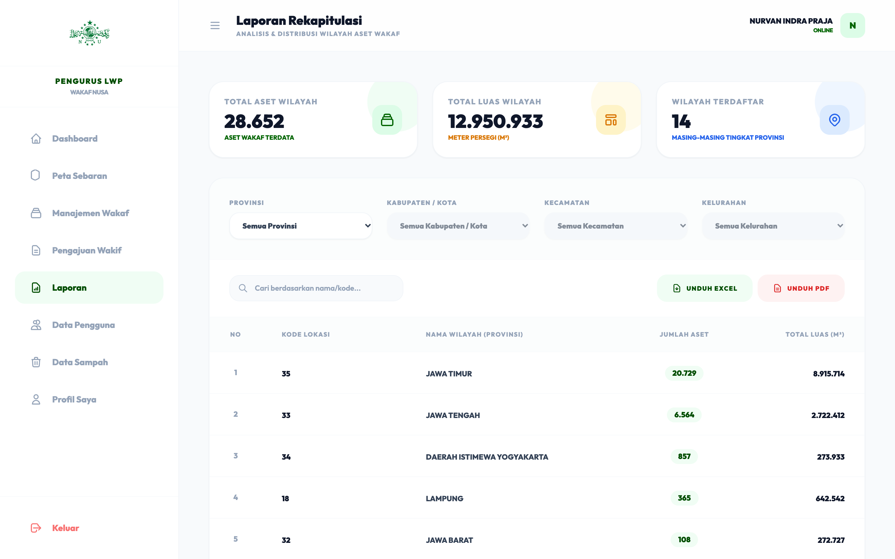

---

## 9. MANAJEMEN PENGGUNA (DATA PENGGUNA & VERIFIKASI AKUN)
*(Menu khusus Administrator / Pengurus Berwenang)*
- **Akses**: Menu Sidebar &rarr; **Data Pengguna**.
- **Fungsi Utama**:
  1. **Verifikasi Pengguna Baru**:
     - Membuka daftar akun yang baru mendaftar dari halaman registrasi.
     - Meninjau identitas, nomor telepon, dan nomor KARTANU pemohon.
     - Mengubah *Level Akses* pemohon dari User Baru (Level 1) menjadi tingkatan resmi:
       - **Level 2 (MWCNU)**: Pengurus tingkat kecamatan.
       - **Level 3 (PCNU)**: Pengurus cabang tingkat kabupaten/kota.
       - **Level 31 (PWNU)**: Pengurus wilayah tingkat provinsi.
     - *Setelah level diberikan oleh Admin, pengguna tersebut baru memiliki izin untuk mengentri dan mengelola data wakaf.*
  2. **Tambah Pengguna Manual**: Admin dapat membuatkan akun langsung untuk pengurus baru.
  3. **Edit & Reset Password**: Membantu pengurus yang lupa kata sandi dengan membuatkan kata sandi baru.
  4. **Hapus / Nonaktifkan Pengguna**: Mencabut hak akses pengguna yang sudah tidak aktif dalam kepengurusan.

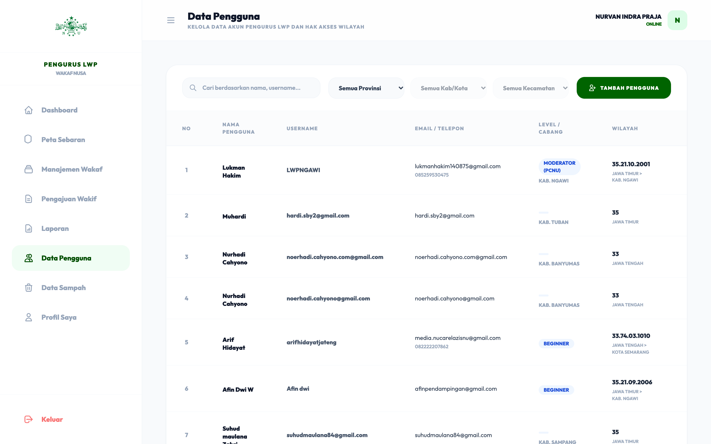

---

## 10. DATA SAMPAH (TEMPAT PEMULIHAN DATA)
- **Akses**: Menu Sidebar &rarr; **Data Sampah**.
- **Fungsi**:
  - Mencegah kehilangan data penting akibat ketidaksengajaan.
  - Memisahkan data aset wakaf dan data pengguna yang pernah dihapus sementara (Soft Delete).
  - **Tombol Pulihkan (Restore)**: Mengembalikan data aset atau pengguna kembali aktif seperti semula.
  - **Tombol Hapus Permanen**: Menghapus data secara permanen dari server apabila sudah tidak diperlukan lagi.

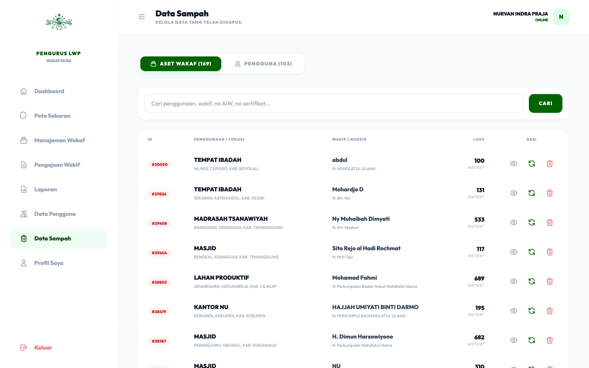

---

## 11. PENGATURAN PROFIL DAN KATA SANDI
- **Akses**: Menu Sidebar &rarr; **Profil Saya**.
- **Fitur**:
  - Memperbarui data pribadi (Nama, Nomor Telepon, Nomor KARTANU).
  - Mengubah Kata Sandi Login: Masukkan kata sandi lama, lalu masukkan kata sandi baru dan konfirmasi kata sandi baru.
  - Mengunggah foto profil resmi pengurus.

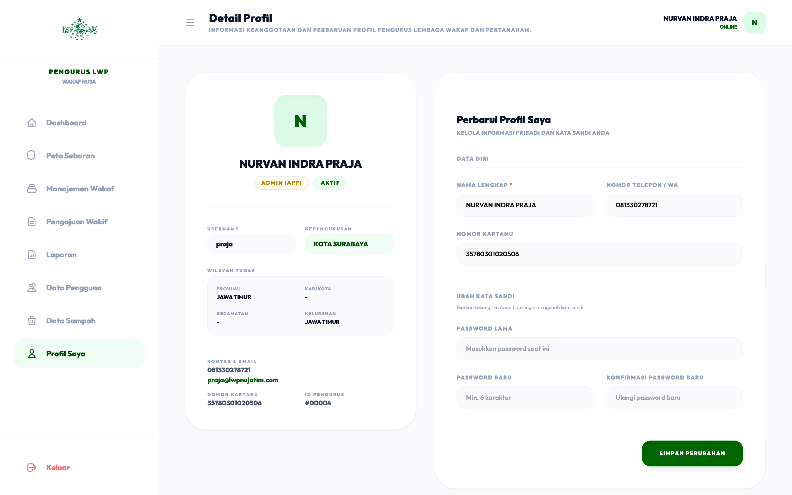

---

## 12. PETUNJUK KEAMANAN & TIPS OPERASIONAL
1. **Kerahasiaan Akun**: Jangan membagikan username dan password kepada pihak yang tidak berkepentingan.
2. **Pencadangan Data**: Lakukan ekspor laporan PDF/Excel secara berkala setiap akhir bulan atau akhir kuartal sebagai arsip fisik dan digital.
3. **Format Berkas**: Saat mengunggah dokumen bukti wakaf, pastikan berkas berformat PDF atau gambar (JPG/PNG) yang terbaca jelas dengan ukuran file wajar (< 5 MB).
4. **Keluar Sistem (Logout)**: Selalu gunakan tombol **Keluar** di bagian bawah sidebar setelah selesai menggunakan aplikasi, terutama jika menggunakan perangkat bersama.

---
*Diterbitkan oleh: Lembaga Wakaf dan Pertanahan Nahdlatul Ulama (LWPNU)*  
*Sistem Informasi Wakaf Nahdlatul Ulama (SIWAKNU)*
